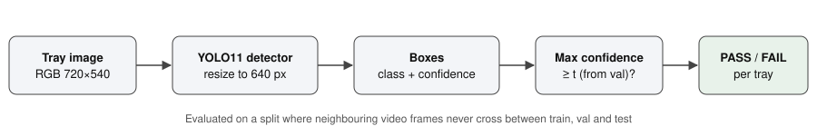
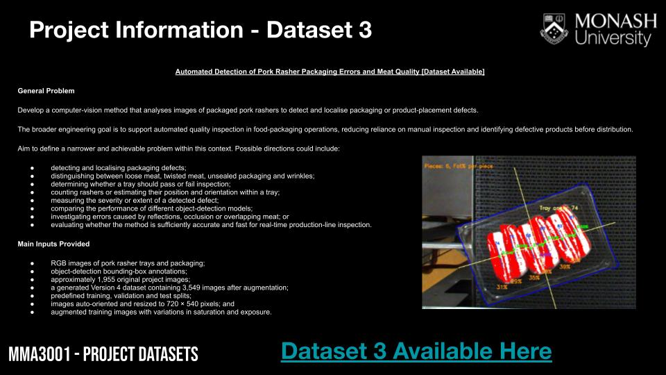

# MMA3001 Project: pork rasher packaging-defect inspection

MMA3001 Numerical Methods and Machine Learning, individual project (2026).

[](https://colab.research.google.com/github/Logan-Das/MMA3001_Project/blob/main/notebooks/02_grouped_pipeline.ipynb)


A computer-vision pipeline that inspects images of sealed pork rasher trays,
localises packaging and placement defects with a YOLO11 object detector, and
turns the detections into a tray-level **PASS / FAIL** decision for a
production line. The project's main contribution is the evaluation: a
leakage-free data split, a pass/fail threshold chosen on validation data, and
latency measured against a line-rate requirement.





## Problem in one paragraph

Manual inspection of sealed trays is slow and inconsistent, and a defective
tray (e.g. an unsealed film) that reaches a customer is a food-safety and
recall risk. Given one RGB image of a tray, the system outputs (1) boxes with a
defect class and confidence, and (2) a FAIL decision if any box reaches the
operating threshold. Missing a defect is treated as worse than a false alarm,
which only costs a manual re-check.

## Inputs and outputs

| | Description |
|---|---|
| **Input** | RGB image of one tray, JPEG/PNG, any size (the dataset is 720 × 540; the detector resizes to 640 px). Overhead view of the packing line, as in the training data. |
| **Output 1** | Boxes `(class, confidence ∈ [0,1], x, y, w, h)`. Classes: `loose-meat`, `packaging-error`, `twisted-meat`, `unsealed`, `wrinkle`. |
| **Output 2** | Tray decision: FAIL if max confidence ≥ *t*, else PASS. *t* is chosen on the validation split to reach ≥ 95 % recall. |
| **Labels** | YOLO text files, one box per line, normalised coordinates. An empty or missing file means a good tray. |
| **Invalid input** | Malformed label lines raise `LabelFormatError` naming the file and line. File names without a frame number stop the split script rather than being guessed. Images from other camera set-ups are out of scope (see Limitations). |

## Repository layout

```
src/porkqc/          Python package (documented, unit-tested)
  labels.py          read and validate YOLO labels
  grouping.py        frame grouping, leakage-free split, perceptual-hash check
  tray_eval.py       pass/fail metrics, threshold selection, Wilson intervals
  timing.py          latency benchmark and GFLOP/s performance model
  detect.py          thin wrapper around Ultralytics (imported lazily)
scripts/             command-line entry points used by the notebook
  make_grouped_split.py, train.py, evaluate_trays.py, benchmark.py
notebooks/
  01_baseline_v4.ipynb      first experiment: YOLO11n on the Roboflow V4 random split
  02_grouped_pipeline.ipynb  leakage-free experiments, run in order on a Colab T4
  colab_git_sync.ipynb      clone / commit / push this repo from Colab
tests/               pytest unit and end-to-end tests (no GPU needed)
results/             metrics from each experiment (CSV/JSON)
docs/                project brief, figures, generated HTML API docs (docs/api)
reports/             generated pytest HTML report
```

## Reproducing the results

1. **Tests and docs (any computer, CPU only)**

   ```bash
   pip install -r requirements.txt
   pip install -e .
   make test     # runs pytest and writes reports/test_report.html
   make docs     # writes docs/api/index.html from the docstrings
   ```

2. **Experiments (Google Colab, T4 GPU).** Open
   `notebooks/02_grouped_pipeline.ipynb` in Colab, add your Roboflow API key as a
   Colab Secret named `ROBOFLOW_API_KEY` (and `GIT_TOKEN` if the repo is private), and run the cells in order. Outputs
   are written to Google Drive.

Random seeds are fixed (`seed=0`, `deterministic=True`) and every split
decision is recorded in `split_manifest.csv`. GPU training is not bit-for-bit
deterministic, so metrics can vary slightly between runs.

## Data

Dataset: [Pork Rasher Error (Packaging) on Roboflow Universe](https://universe.roboflow.com/hello-2aqe0/pork-rasher-error-packaging),
about 1,955 original 720 × 540 frames from video of a packing line, with
bounding-box labels. The images are **not** stored in this repository; the
notebook downloads them. Check the dataset page for its licence.

## Results

| Experiment | Split | Test trays | Tray recall | False-alarm rate | mAP50 | ms / tray |
|---|---|---|---|---|---|---|
| YOLO11n baseline | Roboflow random (leaky) | 80 | 0.94 | 0.08 (1/12) | 0.49 | ≈16.5 |
| YOLO11n | grouped (leakage-free) | *pending* | | | | |
| YOLO11s | grouped (leakage-free) | *pending* | | | | |

The baseline threshold (0.15) was chosen on test data and the split leaks, so
its numbers are optimistic. See `results/baseline_v4_random_split/`.

## Limitations

- One camera set-up and lighting condition; performance on other lines is unknown.
- Rare classes (`loose-meat`, `twisted-meat`, `wrinkle`) have too few examples
  for reliable per-class results.
- Few good trays in the test set, so the false-alarm rate has a wide
  confidence interval.

## AI declaration

I acknowledge the use of AI to assist in the generation, modification, and development of code within this project. AI tools were used to support coding, debugging, and documentation, while all final decisions, implementation, testing, and responsibility for the project's content remain my own.

A dated log of what AI was used for and how it was checked is in [AI_USAGE.md](AI_USAGE.md). Commits written with AI assistance carry a `Co-Authored-By` line.

## Licence

Code: MIT (see `LICENSE`). Dataset and pretrained weights keep their own licences.
